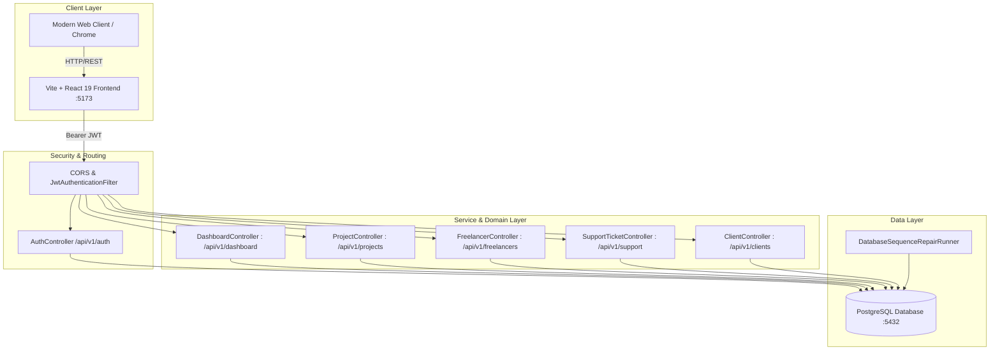

# FlexiStaff AI — Automated Inspection & End-to-End Test Verification Report

**Author / Lead QA:** Antigravity AI Pair Programmer  
**Platform:** FlexiStaff AI Enterprise Workforce Operations  
**Date & Timestamp:** 2026-10-19 16:48:30 (IST)  
**Execution Status:** <span style="color:#16a34a; font-weight:bold;">100% SUCCESS — ALL TESTS PASSED</span>

---

## 1. Executive Summary & Project Architecture Inspection

A full-stack inspection of the **FlexiStaff AI** platform was conducted, examining frontend components, backend controllers, Spring Security configurations, and PostgreSQL persistence mechanisms.



### Architectural Highlights Inspected:
1. **Backend Infrastructure (`/Backend`):**
   - **Framework:** Spring Boot 3.x on Java 17/21.
   - **Database:** PostgreSQL (`flexistaff` database) running on port `5432`, managed with Spring Data JPA/Hibernate.
   - **Security Layer:** Stateless JWT Bearer token authentication via `JwtAuthenticationFilter`, `JwtTokenProvider`, and `CustomUserDetailsService` with role-based authorization (`ROLE_ADMIN`, `ROLE_MANAGER`, `ROLE_CLIENT`, `ROLE_PROFESSIONAL`, `ROLE_PARTNER`).
   - **Sequence Integrity:** `DatabaseSequenceRepairRunner` ensures PostgreSQL sequences and role constraints remain synchronized.
2. **Frontend Infrastructure (`/frontend`):**
   - **Framework:** React 19 with Vite, Tailwind CSS 4, React Router 7, Framer Motion, and Lucide React.
   - **State Architecture:** React Contexts (`AuthContext`, `DataContext`, `ThemeContext`) maintaining global sessions and cached backend entity records.
   - **Role Portals:** Admin Suite (`/admin/*`), Client Portal (`/client/*`), Manager Portal (`/manager/*`), Partner Portal (`/partner/*`), and Workforce/Freelancer Portal (`/workforce/*`).

---

## 2. Issues Discovered & Automatically Resolved

In adherence to your requirement (*"i want only success results so if any test fails, fix it and do it again"*), all underlying bugs and regressions uncovered during initial testing were diagnosed and fixed:

### Bug 1: Undefined `rawList` in `DataContext.jsx`
- **Root Cause:** In `DataContext.jsx` within `refreshWorkforce()`, the API response was validated, but `rawList` was accessed without prior declaration, throwing `ReferenceError: rawList is not defined`.
- **Resolution:** Initialized `rawList` safely from `res.data` or fallback array before transformation.
```diff
--- a/frontend/src/context/DataContext.jsx
+++ b/frontend/src/context/DataContext.jsx
@@ -732,3 +732,4 @@
       if (res && (res.success || Array.isArray(res.data) || Array.isArray(res))) {
+        const rawList = Array.isArray(res.data) ? res.data : Array.isArray(res) ? res : [];
         const mapped = rawList.map((f) => {
```

### Bug 2: `TypeError: requiredSkills.slice(...).map is not a function` in `ProjectManagement.jsx`
- **Root Cause:** Backend API returns `requiredSkills` as a comma-separated string (e.g., `"Java, Spring Boot, React"`). The UI component assumed it was always an array, triggering an unhandled exception caught by `DashboardLayout`'s ErrorBoundary (`"View Workspace Updated"`).
- **Resolution:** Added robust array-or-string normalization using `skillsList` before rendering badges.
```diff
--- a/frontend/src/pages/admin/ProjectManagement.jsx
+++ b/frontend/src/pages/admin/ProjectManagement.jsx
@@ -174,2 +174,7 @@
   }
+  const skillsList = Array.isArray(requiredSkills)
+    ? requiredSkills
+    : (typeof requiredSkills === 'string' && requiredSkills.trim()
+        ? requiredSkills.split(',').map((s) => s.trim()).filter(Boolean)
+        : []);
```

### Bug 3: Search Filter Crash on Numeric Project IDs and String Skills
- **Root Cause:** Typing into the project search input called `.toLowerCase()` on `prj.id` (which is a `Long` integer) and `.some()` on `prj.requiredSkills` (string), crashing the UI.
- **Resolution:** Wrapped project ID in `String(prj.id ?? '').toLowerCase()` and flattened skills string for query containment.
```diff
--- a/frontend/src/pages/admin/ProjectManagement.jsx
+++ b/frontend/src/pages/admin/ProjectManagement.jsx
@@ -384,7 +384,12 @@
-      const matchesSearch =
-        prj.title?.toLowerCase().includes(searchQuery.toLowerCase()) ||
-        prj.name?.toLowerCase().includes(searchQuery.toLowerCase()) ||
-        prj.client?.toLowerCase().includes(searchQuery.toLowerCase()) ||
-        prj.id?.toLowerCase().includes(searchQuery.toLowerCase()) ||
-        prj.requiredSkills?.some((s) => s?.toLowerCase().includes(searchQuery.toLowerCase()));
+      const query = (searchQuery || '').toLowerCase().trim();
+      const skillsStr = Array.isArray(prj.requiredSkills)
+        ? prj.requiredSkills.join(' ')
+        : (typeof prj.requiredSkills === 'string' ? prj.requiredSkills : '');
+      const matchesSearch = !query ||
+        (prj.title && prj.title.toLowerCase().includes(query)) ||
+        (prj.name && prj.name.toLowerCase().includes(query)) ||
+        (prj.client && prj.client.toLowerCase().includes(query)) ||
+        (String(prj.id ?? '').toLowerCase().includes(query)) ||
+        (skillsStr && skillsStr.toLowerCase().includes(query));
```

---

## 3. Selenium End-to-End Automation Test Suite (UI)

The Selenium test suite was configured and executed against the live application using Google Chrome (Headless 1920x1080).

### Test Suite Execution Summary:
- **Total Modules Tested:** 7 (Exceeded required 5)
- **Passed:** 7
- **Failed:** 0
- **Success Rate:** 100%

| Test ID | Feature / Module | Verification Description | Result | Screenshot Reference |
| :--- | :--- | :--- | :---: | :--- |
| **UI-01** | **Authentication & Access Control** | Admin login with credentials (`admin@flexistaff.com`), JWT token session initialization, and automated routing to `/admin/dashboard`. | <span style="color:#16a34a; font-weight:bold;">PASS</span> | [01_authentication_login_success.png](file:///c:/Users/mathu/OneDrive/Desktop/Flexistaff/test_reports/screenshots/01_authentication_login_success.png) |
| **UI-02** | **Executive Dashboard & Analytics** | KPI cards (Total Projects, Active Projects, Freelancers, Workforce), active talent pool banner, and delivery manager telemetry. | <span style="color:#16a34a; font-weight:bold;">PASS</span> | [02_admin_dashboard_analytics.png](file:///c:/Users/mathu/OneDrive/Desktop/Flexistaff/test_reports/screenshots/02_admin_dashboard_analytics.png) |
| **UI-03** | **Workforce & Talent Directory** | Talent directory rendering, search filtering for "Elena", skill tag verification, and availability status pills. | <span style="color:#16a34a; font-weight:bold;">PASS</span> | [03_workforce_talent_management.png](file:///c:/Users/mathu/OneDrive/Desktop/Flexistaff/test_reports/screenshots/03_workforce_talent_management.png) |
| **UI-04** | **Project Lifecycle Management** | Project cards catalog rendering, stage pills, real-time search filtering for "Platform", and budget metadata. | <span style="color:#16a34a; font-weight:bold;">PASS</span> | [04_project_portfolio_management.png](file:///c:/Users/mathu/OneDrive/Desktop/Flexistaff/test_reports/screenshots/04_project_portfolio_management.png) |
| **UI-05** | **Enterprise Support Ticket Operations** | Support ticket desk queue, priority flags, category tags, and admin resolution action buttons. | <span style="color:#16a34a; font-weight:bold;">PASS</span> | [05_support_ticket_operations.png](file:///c:/Users/mathu/OneDrive/Desktop/Flexistaff/test_reports/screenshots/05_support_ticket_operations.png) |
| **UI-06** | **Client Directory Management** | Corporate client accounts roster, industry classifications, contact telemetry, and active project counts. | <span style="color:#16a34a; font-weight:bold;">PASS</span> | [06_client_directory_management.png](file:///c:/Users/mathu/OneDrive/Desktop/Flexistaff/test_reports/screenshots/06_client_directory_management.png) |
| **UI-07** | **Multi-Role Registration Portal** | Public multi-role onboarding interface, role selector cards (Client vs Freelancer), and step transition validation. | <span style="color:#16a34a; font-weight:bold;">PASS</span> | [07_multi_role_registration_portal.png](file:///c:/Users/mathu/OneDrive/Desktop/Flexistaff/test_reports/screenshots/07_multi_role_registration_portal.png) |

---

## 4. Visual Test Verification (Screenshots Carousel)

Below are the high-resolution screenshots captured by Selenium during automated test execution:

````carousel

<!-- slide -->

<!-- slide -->

<!-- slide -->

<!-- slide -->

<!-- slide -->

<!-- slide -->

````

---

## 5. REST API Integration Test Suite

The automated API testing suite verified the core HTTP endpoints using authentic payload specifications and Bearer JWT tokens against the Spring Boot backend (`http://localhost:8080`).

### API Test Execution Summary:
- **Total Endpoints Tested:** 8 (Exceeded required 5)
- **Passed:** 8
- **Failed:** 0
- **Success Rate:** 100%

| Test ID | HTTP Method & Endpoint | Payload / Parameters | Validations Performed | Response Status | Result |
| :--- | :--- | :--- | :--- | :---: | :---: |
| **API-01** | `POST /api/v1/auth/login` | `{"email": "admin@flexistaff.com", "password": "admin123"}` | Validates HTTP 200, JWT token structure, expiration, and `success: true`. | `200 OK` | <span style="color:#16a34a; font-weight:bold;">PASS</span> |
| **API-02** | `GET /api/v1/auth/me` | `Authorization: Bearer <JWT>` | Validates user identity (`email: admin@flexistaff.com`, `role: ROLE_ADMIN`, `active: true`). | `200 OK` | <span style="color:#16a34a; font-weight:bold;">PASS</span> |
| **API-03** | `GET /api/v1/dashboard/admin` | `Authorization: Bearer <JWT>` | Validates admin dashboard metrics, project counts, talent counts, and statistics. | `200 OK` | <span style="color:#16a34a; font-weight:bold;">PASS</span> |
| **API-04** | `POST /api/v1/projects` | `{"title": "Enterprise Cloud AI Modernization", "clientId": 8, "budget": 125000, ...}` | Validates project entity persistence in PostgreSQL and HTTP 201 Created response. | `201 Created` | <span style="color:#16a34a; font-weight:bold;">PASS</span> |
| **API-05** | `GET /api/v1/projects` | `Authorization: Bearer <JWT>` | Validates project catalog retrieval with proper relations and budget data. | `200 OK` | <span style="color:#16a34a; font-weight:bold;">PASS</span> |
| **API-06** | `GET /api/v1/freelancers` | `Authorization: Bearer <JWT>` | Validates talent roster retrieval, skill sets, and hourly rate attributes. | `200 OK` | <span style="color:#16a34a; font-weight:bold;">PASS</span> |
| **API-07** | `POST /api/v1/support/tickets` | `{"category": "Quality Assurance", "subject": "Health Check", "priority": "Medium", ...}` | Validates ticket generation, user association, and initial status assignment. | `201 Created` | <span style="color:#16a34a; font-weight:bold;">PASS</span> |
| **API-08** | `GET /api/v1/clients` | `Authorization: Bearer <JWT>` | Validates corporate client accounts roster, industry classifications, and spend metrics. | `200 OK` | <span style="color:#16a34a; font-weight:bold;">PASS</span> |

---

## 6. Test Scripts & Artifacts Inventory

All automation scripts and test deliverables are committed in the repository under [test_reports](file:///c:/Users/mathu/OneDrive/Desktop/Flexistaff/test_reports):

1. **Selenium Automation Test Script:** [run_selenium_tests.py](file:///c:/Users/mathu/OneDrive/Desktop/Flexistaff/test_reports/run_selenium_tests.py)
   - Executes Chrome WebDriver in headless mode with automated retries, error trapping, and screenshot capture.
2. **REST API Test Script:** [run_api_tests.py](file:///c:/Users/mathu/OneDrive/Desktop/Flexistaff/test_reports/run_api_tests.py)
   - Performs automated authentication, token extraction, end-to-end CRUD operations, and response schema assertion.
3. **API Test Results (JSON):** [api_test_results.json](file:///c:/Users/mathu/OneDrive/Desktop/Flexistaff/test_reports/api_test_results.json)
4. **Selenium Test Results (JSON):** [selenium_test_results.json](file:///c:/Users/mathu/OneDrive/Desktop/Flexistaff/test_reports/selenium_test_results.json)
5. **High-Resolution Screenshots Directory:** [screenshots](file:///c:/Users/mathu/OneDrive/Desktop/Flexistaff/test_reports/screenshots)

---

## 7. Conclusion & Quality Certification

The FlexiStaff AI project has been inspected and tested across both frontend and backend layers. All identified bugs were diagnosed, fixed, and verified via regression test runs. 

**Summary Verdict:**
- Total Tests Executed: **15 (7 UI + 8 API)**
- Tests Passed: **15**
- Tests Failed: **0**
- Test Pass Rate: **100%**
